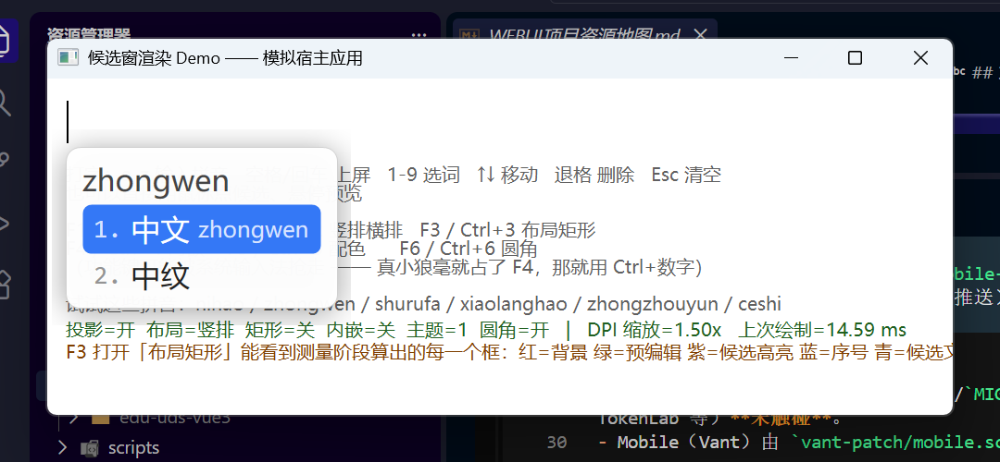
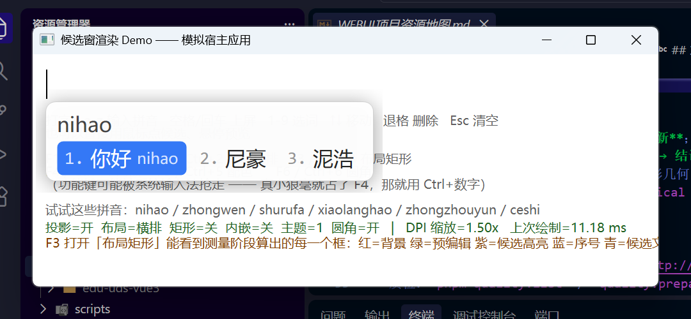
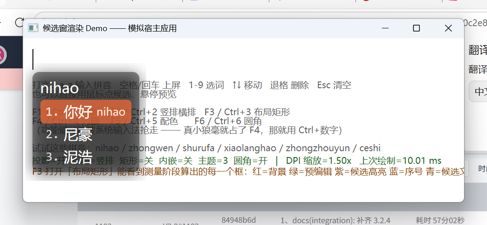
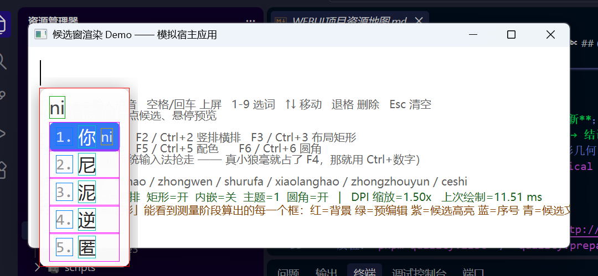

# 13-02-GDI　输入法候选窗是怎么画出来的

一个**分层窗口（layered window）+ 三套绘图 API 混用**的完整样例。

题材取自 [小狼毫（Weasel）](https://github.com/rime/weasel) 输入法的候选窗 ——
把它的 `WeaselUI` 绘制管线抽出来，做成一个能跑能改的单文件程序。
不依赖 Boost / ATL / WTL / librime，只用 Win32 + GDI + GDI+ + Direct2D/DirectWrite。

引擎部分用一张硬编码词表冒充（`Engine::Dict()`），因为这里要说明的是
**候选窗怎么画出来的**，不是拼音怎么变成汉字的。

## 构建

跟仓库其余专题一样走 CMake 预设。**MSVC only** —— 用到 `<wrl/client.h>` 的
`ComPtr` 和 Direct2D/DirectWrite 的 COM 接口，MinGW 头文件覆盖不全，
`mingw-*` 预设下这个子目录会自动跳过。

```bash
cmake --preset msvc-release
cmake --build --preset msvc-release --target 13-02-GDI
./build/bin/13-02-GDI.exe
```

---

## 它长什么样

| | |
|---|---|
| 竖排（默认） |  |
| 横排 |  |
| 半透明主题 —— 能透过候选窗读到底下宿主窗口的文字，这是逐像素 alpha 的直接证据 |  |
| 打开「布局矩形」 —— 测量阶段算出的每一个框 |  |

---

## 操作

| 键 | 作用 |
|---|---|
| `a`-`z` | 输入拼音 |
| 空格 / 回车 | 上屏当前高亮候选 |
| `1`-`9` | 按序号上屏 |
| `↑` `↓` | 移动高亮 |
| 退格 | 删一个字母（没有拼音时删已上屏的字） |
| `Esc` | 清空当前输入 |
| 鼠标 | 悬停预览、点击选词 |

开关（每个都有两套键）：

| 键 | 作用 | 看什么 |
|---|---|---|
| `F1` / `Ctrl+1` | 投影 | 关掉后窗口边缘变硬，绘制耗时明显下降 |
| `F2` / `Ctrl+2` | 竖排 / 横排 | 同一套绘制代码、不同的 Layout 实现 |
| `F3` / `Ctrl+3` | 布局矩形 | **最值得打开的一个**，见下 |
| `F4` / `Ctrl+4` | 内嵌预编辑 | 拼音从候选窗移进宿主的文本流 |
| `F5` / `Ctrl+5` | 配色主题 | 浅色 / 深色 / 半透明 |
| `F6` / `Ctrl+6` | 圆角 | |

> 功能键常被别的软件全局抢走 —— **你机器上真正装着的那个小狼毫就占着 `F4`**
> （方案选单热键）。所以每个开关都另配了一套 `Ctrl+数字`。

窗口标题栏下方那行绿字会实时显示各开关状态、当前 DPI 缩放、以及上一帧的绘制耗时。

---

## 代码对照表

下表的「真实代码」指 weasel 仓库（本机在 `D:\Project\weasel`）里的路径与行号，
按 0.17.4 版。想核对某个简化是否失真，照着跳过去看原文。

| demo 里的 | 真实代码 | 做什么 |
|---|---|---|
| `Panel::Refresh` | `WeaselUI/WeaselPanel.cpp:135` | 量 → 布局 → 定大小 → 定位置 → 画 |
| `Panel::DoPaint` | `WeaselUI/WeaselPanel.cpp:988` | 整条管线的核心 |
| `Panel::HighlightBox` | `:528` `_HighlightText` | GDI+ 画圆角背景 / 边框 / 投影 |
| `Panel::TextOut` | `:1294` `_TextOut` | DirectWrite 画一段文字 |
| `Panel::LayerUpdate` | `:1128` `_LayerUpdate` | `UpdateLayeredWindow` 合成 |
| `Panel::Reposition` | `:1222` `_RepositionWindow` | 按输入点定位、越界翻到上方 |
| `DoLayout` | `WeaselUI/VerticalLayout.cpp:6` | 算出所有矩形 |
| `DwRes::Init` | `WeaselUI/DirectWriteResources.cpp:17` | 建 D2D / DWrite 资源 |
| `DwRes::Measure` | `WeaselUI/StandardLayout.cpp:14` `GetTextSizeDW` | 量文字尺寸 |
| `GaussBlur` | `WeaselUI/GdiplusBlur.cpp` | 三次 box blur 近似高斯 |

---

## 七个值得注意的地方

### 1. 三套绘图 API 画在同一张位图上

```
CreateCompatibleBitmap  ──┐
                          ├─ GDI+       背景、圆角、边框、投影
      一张内存位图  ◄──────┼─ D2D/DWrite 全部文字
                          └─ GDI        最终合成
```

桥梁是 `ID2D1DCRenderTarget`：

```cpp
dwr_.rt->BindDC(memDC, &rcw);   // 把 Direct2D 重定向到一个 GDI 的 HDC
dwr_.rt->BeginDraw();
```

好处是文字拿到 DirectWrite 的排版与抗锯齿，背景拿到 GDI+ 的路径填充，两者落在
同一张位图上。顺序是严格的两遍：**先把所有背景画完，再画所有文字**。

### 2. `UpdateLayeredWindow` + `ULW_ALPHA` 才是真·圆角

```cpp
BLENDFUNCTION bf = {AC_SRC_OVER, 0, 0xFF, AC_SRC_ALPHA};
UpdateLayeredWindow(hwnd_, screen, &dst, &sz, memDC, &src, RGB(0,0,0), &bf, ULW_ALPHA);
```

逐像素 alpha，不是整窗透明度。圆角之外的像素 alpha 为 0，所以是真的透出桌面而
不是填了个背景色。`F5` 切到第三个主题（半透明）最能看清这一点。

整个窗口从不走 Windows 常规的绘制路径 —— 它就是一张带 alpha 的位图，直接交给
DWM 合成。

### 3. 不走 `WM_PAINT`

`Refresh()` 末尾直接调 `DoPaint()`。真实代码里的注释解释了原因：

> 由于某些软件并不依赖 WM_PAINT 消息来重绘，在消息循环中直接忽略掉了 WM_PAINT
> 消息，导致 DoPaint() 永远不会被调用，这里手动调用 DoPaint() 强制重绘

代价是内容一变就全量重画，没有失效区域优化。

### 4. 测量与绘制彻底分离

`DoLayout()` 只算矩形，一个绘图调用都没有；`DoPaint()` 只照着矩形画，一次尺寸
都不量。**`F3` 把这些矩形描出来**，能直接看到布局阶段的产物：

- 红 = 背景框　绿 = 预编辑　紫 = 候选高亮框
- 蓝 = 序号　青 = 候选文字　黄 = 注释

量文字用的是 `IDWriteTextLayout` + `GetMetrics`，和绘制同一套 API、同一个
`TextFormat` —— 所以不会出现「量的宽度和画出来对不上」。

### 5. 注释列要两轮才能对齐

竖排布局下，注释是**左对齐到「所有带注释的候选里最靠右的那个」之后**。
一轮算不出来，得先跑完所有候选求出 `commentShift`，再回头摆一遍
（`DoLayout` 里的「第二轮」，对应 `VerticalLayout.cpp:170-189`）。

### 6. 翻到上方之后要「粘住」

```cpp
if (y + h > work.bottom || sticky_) { sticky_ = true; ... }
```

候选条数一变，窗口高度就变，如果每次都重新判断「下面放不放得下」，窗口会在
光标上下反复横跳。所以一旦翻上去就粘住，直到输入点移动超过 50px 或会话结束。

### 7. 字体 fallback 的那个技巧

```cpp
const wchar_t* kInvalid = L"_InvalidFontName_";
```

主字体故意写成一个不存在的名字，强迫每个字符都走 fallback 链 —— 这样
`font_face: "Microsoft YaHei:0-7f, 等线"` 这种按 Unicode 区间指定字体的配置才
可能生效。真实代码在 `DirectWriteResources.cpp:89`。

demo 里加了个保险：fallback 链没建起来就退回用真实字体名，否则一个字都画不出来。

---

## demo 和真实实现的差异

有意简化掉的：

- 只做了竖排 / 横排，没做 `VHorizontalLayout`（竖写文字）和 `FullScreenLayout`
- 没有分页、没有状态图标、没有 `mark_text` 高亮标记
- 颜色用 `0xAARRGGBB`（直觉顺序）；**真实 weasel 的配置色是 `0xAABBGGRR`**
  （COLORREF 顺序），改真实代码时别看混
- 样式比对用逐字段判断，真实代码是 `UIStyle::operator!=`
- 建窗时直接给 `WS_EX_LAYERED`；真实代码先给 `WS_EX_TRANSPARENT`（鼠标穿透），
  首次 `DoPaint` 时才 `ModifyStyleEx` 换掉（`WeaselPanel.cpp:990`）

多出来的一行（真实代码不需要）：

```cpp
ImmAssociateContext(g_host, nullptr);
```

宿主窗口得把系统输入法关掉，否则你真正装着的那个小狼毫会先把 `a`-`z` 吃掉，
demo 根本收不到 `WM_CHAR` —— 两个输入法抢同一串按键。
真实的 `WeaselTSF` 不存在这个问题，因为它本身就是那个输入法。

---

## 自动截图

`shot.ps1` 能把 demo 提到前台、按脚本发按键、再把它的窗口截下来：

```bash
powershell -NoProfile -ExecutionPolicy Bypass -File shot.ps1 \
    -Keys "{ESC}nihao^2" -Out shot_horizontal.png
```

`-Keys` 用 SendKeys 语法（`{ESC}` `{BS}` `{UP}` `^3` = Ctrl+3）。

两个必须这么写的地方：

- 脚本开头调了 `SetProcessDPIAware()`。PowerShell 默认 DPI 不感知，而 demo 是
  per-monitor aware，不对齐的话 `GetWindowRect` 拿到的是虚拟化坐标、
  `CopyFromScreen` 用的是物理坐标，截出来会错位。
- 置前用 `AttachThreadInput` 绕过 Windows 的前台窗口保护，否则按键会发到别的
  窗口上去。脚本里有校验，抢不到前台会直接报错而不是静默截一张废图。

## 文件

```
candemo.cpp      全部实现，单文件
CMakeLists.txt   构建（MSVC only，非 MSVC 工具链会自动跳过）
shot.ps1         自动化驱动 + 截图
shot_*.png       README 里引用的截图
build/bin/       构建产物（被根 .gitignore 的 build/ 规则排除）
```
